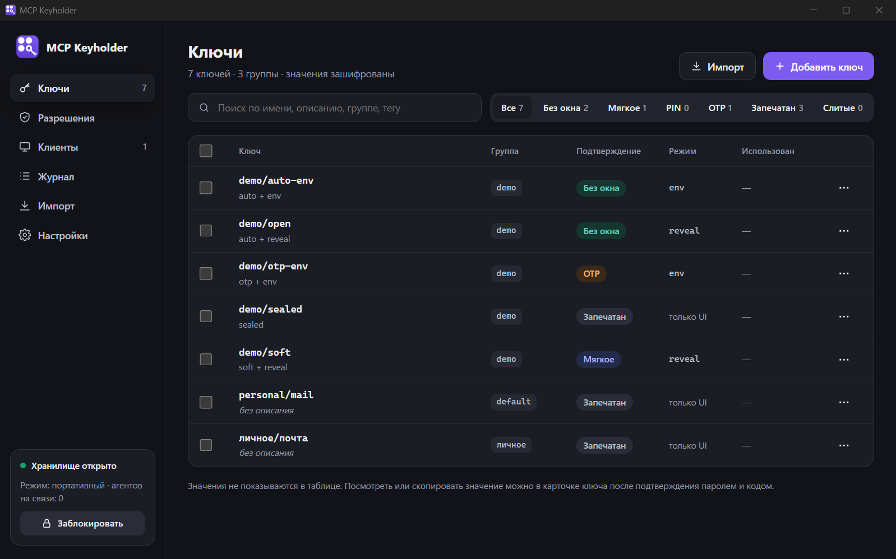
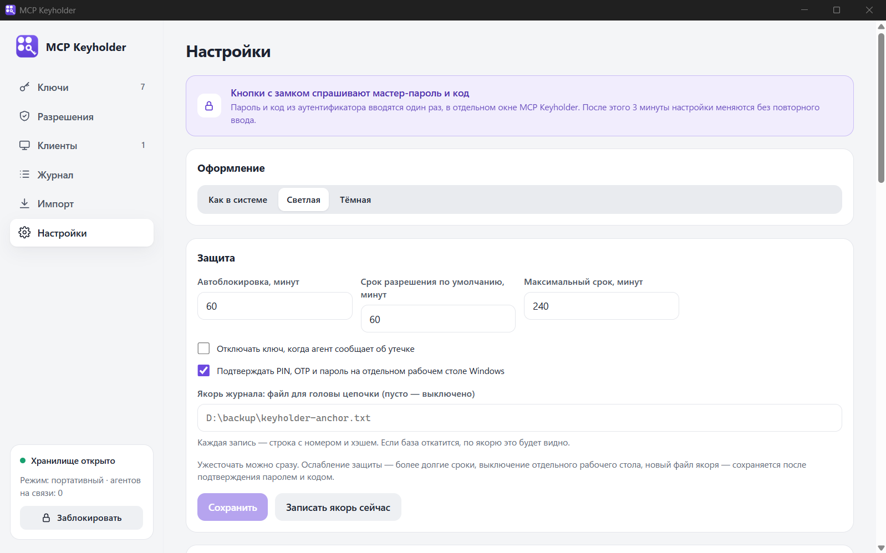

<div align="center">


# MCP Keyholder

**A local secrets vault for AI agents.** Agents get API keys over MCP only after you approve, and every access is logged.

[](https://github.com/Bifapa/mcp-keyholder-releases/releases/latest)
[](LICENSE)


[Русский](README.ru.md) · [Download](https://github.com/Bifapa/mcp-keyholder-releases/releases/latest) · [Changelog](CHANGELOG.md) · [Security](SECURITY.md)



</div>

## Why

API keys for agents usually end up in `.env` files, chat history and shell profiles. MCP Keyholder keeps them encrypted in one place and hands them to agents only after you approve. Important keys need a code from your authenticator app, and the most sensitive ones never leave the vault.

## Features

- **Encrypted vault.** Argon2id master password, XChaCha20-Poly1305 for every value, signed key policies. Edits made around the app are detected.
- **Grants, not passwords.** An agent asks for a set of keys once and gets them for a limited time. Anything outside the grant is refused.
- **Approval levels per key:**
  - **No window**;
  - **Soft** (one click);
  - **PIN**;
  - **OTP** (one code approves one request);
  - **Sealed** (never given to agents).
- **Codes are typed on a separate Windows desktop**, never in a chat and never in a webview.
- **Two ways to deliver a key:**
  - `reveal`: the value comes back in the MCP response;
  - `env`: `kh run` puts the key into a child process environment, so the agent never sees the value.
- **Leaks.** Agents can report a leaked key (`report_leak`), and the vault can search text for its values (`check_leak`, `kh scan`).
- **Audit log** with an HMAC chain, integrity check and an external anchor file.
- **Service mode.** The core runs as a Windows service under its own account, so your user's processes cannot read its memory.
- **Your own records.** Sealed keys hold any text: multi-line notes, names in any language.
- **Moving between computers** with an encrypted `.mcpkey` file that opens with the master password.
- **Works offline.** Nothing goes over the network except the optional update check.
- **Signed automatic updates.**
- Light and dark themes, tray icon, bulk editing, import from `.txt`.



## Install

Download `MCP-Keyholder_x.y.z_x64-setup.exe` from the [latest release](https://github.com/Bifapa/mcp-keyholder-releases/releases/latest) and run it. No administrator rights are needed. The app updates itself.

On first launch:

1. Set a master password and an anti-phishing word.
2. Scan the QR code with an authenticator app (Google Authenticator, Aegis, 1Password, …), save the recovery codes and enter a code.
3. Add keys, or move an existing vault from a `.mcpkey` file.

## Connect an agent

Go to **Clients**, choose **Add client** and confirm. MCP Keyholder shows a ready command, for example for Claude Code:

```bash
claude mcp add keyholder --scope user -e KH_TOKEN=<token> -- "C:\Users\<you>\AppData\Local\MCP Keyholder\kh.exe" mcp
```

It also shows the JSON config for other MCP clients. The agent gets these tools:

| Tool | What it does |
|---|---|
| `list_secrets` | names, descriptions, levels and modes, without values |
| `request_grant` | asks for access to keys (or a preset) and waits for your decision |
| `my_grants` | active grants of the session |
| `get_secret` | the value of a `reveal` key from a grant |
| `prepare_run` | a one-time ticket for `kh run` (`env` mode) |
| `report_leak` | the agent reports that a key leaked |
| `check_leak` | searches text for vault values |

## Security model

The design, the threat model and the acceptance tests are in [CONCEPT.md](CONCEPT.md) (in Russian). In short:

- The master password never leaves memory.
- Codes are checked locally.
- Every value is bound to its record and policy, so ciphertexts cannot be moved between records or relabelled.
- Approval windows show verified facts (client, process), the agent's own claim separately, and your anti-phishing word.

Found a vulnerability? See [SECURITY.md](SECURITY.md).

## Build from source

You need Rust (stable), Node.js 20+ and Visual Studio Build Tools.

```bash
cargo test -p kh-core -p kh-daemon
cd app && npm install && npx tauri dev
```

`scripts/install.ps1` builds the app and installs it for the current user. `scripts/release.ps1` builds the signed installer. Development switches are listed in [README.ru.md](README.ru.md#разработка).

| Folder | What is inside |
|---|---|
| `crates/kh-core` | vault, crypto, TOTP, audit log, leak search, IPC protocol |
| `crates/kh-daemon` | the core without UI: grants, sessions, approval queue, channels |
| `crates/kh-service` | the Windows service |
| `crates/kh-cli` | `kh`: MCP server over stdio, `kh run`, `kh scan` |
| `app` | the Tauri app (Rust) and the interface (React + TypeScript) |

## License

[Apache License 2.0](LICENSE) © 2026 Bifastack
